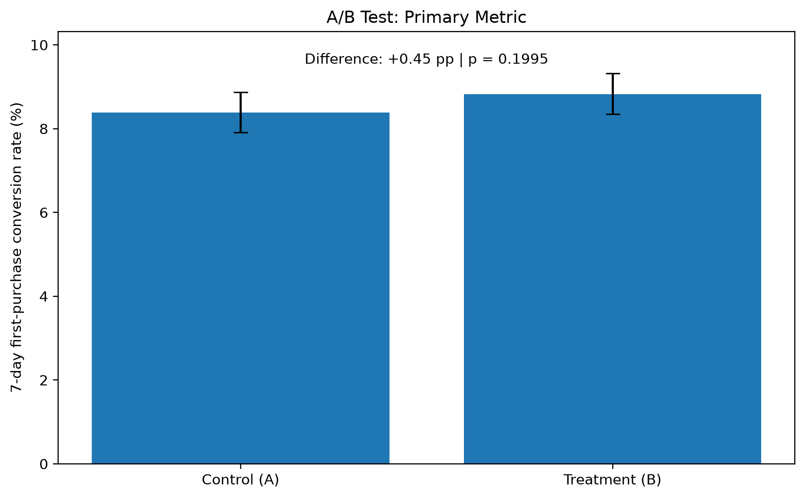
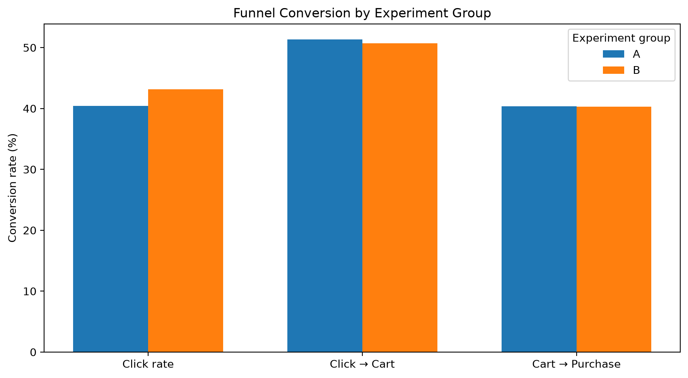
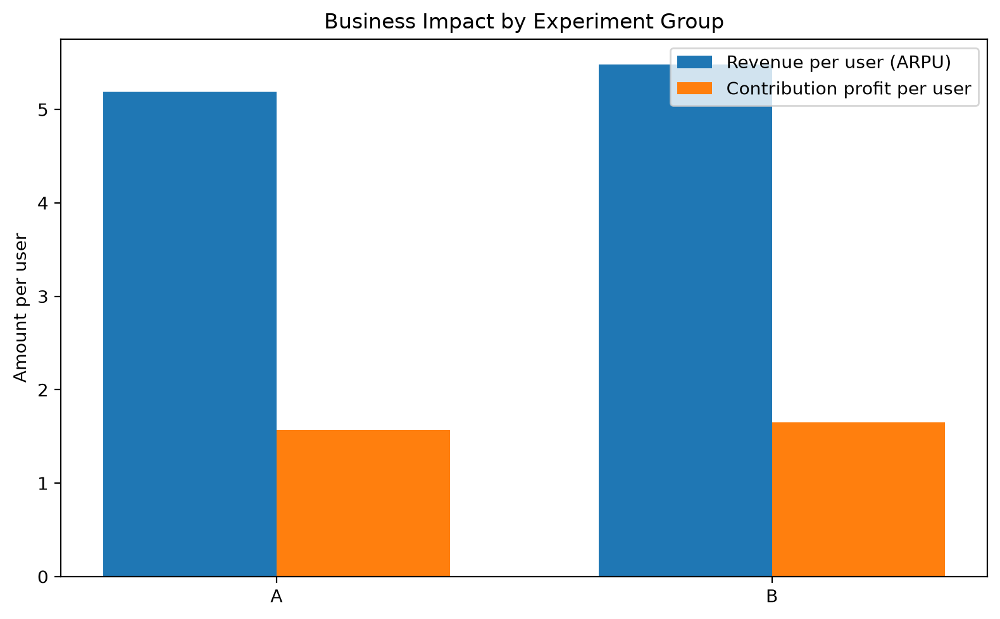
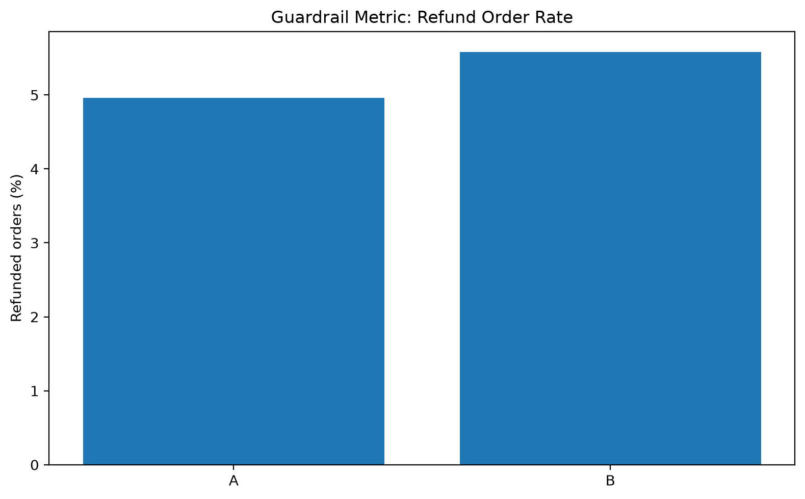

# A/B Test Growth Analysis: Personalized Recommendation

## 1. Project Overview

This project evaluates whether adding a personalized product recommendation module to the homepage improves new-user conversion and business performance.

A simulated e-commerce experiment is conducted with two groups:

- **Control Group (A):** Existing homepage experience.
- **Treatment Group (B):** Homepage with a personalized recommendation module.

The analysis covers experiment design, funnel conversion, statistical inference, user retention, revenue, contribution profit, and business guardrail metrics.

> **Disclaimer:** This is a portfolio project based on simulated data. The experiment results are illustrative and do not represent a real company's performance.

## 2. Business Questions

- Does the recommendation module improve the 7-day first-purchase conversion rate?
- At which stage of the user funnel does the treatment have the greatest impact?
- Does the observed conversion change correspond to higher revenue and contribution profit?
- Are there potential negative effects, such as an increase in the refund rate?

## 3. Experiment Design

| Item | Setting |
|---|---|
| Experiment unit | New user |
| Control group | Existing homepage |
| Treatment group | Homepage with recommendation module |
| Allocation ratio | 1:1 |
| Planned sample size | Approximately 26,000 users |
| Primary metric | 7-day first-purchase conversion rate |
| Significance level | 5%, two-sided |
| Statistical power target | 80% |
| Minimum detectable effect | 1 percentage point |

The sample-size assumptions use an 8% baseline conversion rate and a 9% target conversion rate. These are planning assumptions for the simulated experiment, not actual industry benchmarks.

## 4. Tech Stack

- **SQL / MySQL:** Funnel, retention, revenue, and contribution-profit analysis.
- **Python:** Data processing, statistical testing, and visualization.
- **pandas / NumPy:** Data manipulation.
- **Matplotlib:** Result visualization.
- **Jupyter Notebook:** Reproducible analysis workflow.

## 5. Key Results

### Primary Metric

- Control conversion rate: **8.38%**
- Treatment conversion rate: **8.82%**
- Absolute difference: **+0.45 percentage points**
- p-value: **0.1995**
- 95% confidence interval for the difference: **−0.24 to +1.13 percentage points**

The treatment group has a higher observed conversion rate, but the difference is not statistically significant at the 5% level. The experiment therefore does not provide sufficient evidence that the recommendation module improves the primary metric.

### Funnel Analysis

The treatment group's click rate is approximately **43.18%**, compared with **40.42%** in the control group. The observed improvement is concentrated at the click stage; downstream conversion rates do not show a comparable improvement.

### Business Impact

| Metric | Control (A) | Treatment (B) |
|---|---:|---:|
| Revenue per user (ARPU) | 5.19 | 5.48 |
| Contribution profit per user | 1.57 | 1.65 |
| Refund order rate | 4.96% | 5.58% |

These figures are descriptive comparisons. The revenue and contribution-profit differences have not been statistically tested, and the figures do not deduct the incremental cost of developing and maintaining the recommendation module.

## 6. Visualizations

## 7. Business Recommendation

The results suggest that the recommendation module may attract more product clicks, but the current experiment does not establish a statistically significant improvement in 7-day first-purchase conversion.

A full rollout should not be recommended solely on the basis of the observed conversion and profit differences. Further testing, downstream funnel optimization, refund-rate monitoring, and a more complete cost-benefit analysis are needed before making a rollout decision.

## 8. Limitations

- All data are simulated; the results are not evidence of real-world treatment effects.
- Revenue and contribution-profit comparisons are descriptive and have not been statistically tested.
- The incremental cost of the recommendation module is based on a hypothetical assumption.
- The simulation simplifies real user behavior, order frequency, and refund dynamics.

## 9. How to Reproduce

1. Install the Python dependencies listed in `requirements.txt`.
2. Run `notebooks/01_generate_data.ipynb` to generate the simulated datasets.
3. Import the generated CSV files into MySQL and execute the SQL scripts.
4. Export the query results into the `results/` directory.
5. Run `notebooks/02_ab_test_analysis.ipynb` to perform statistical testing and generate the visualizations.

